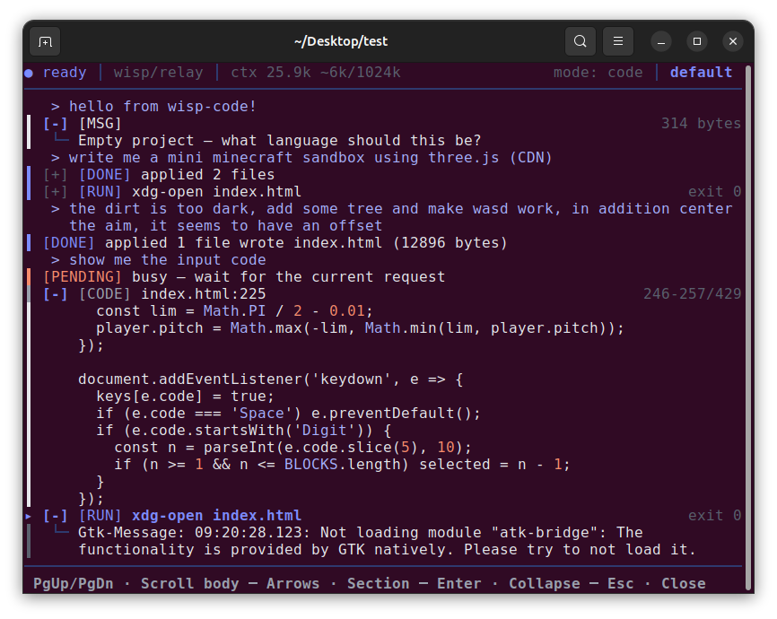

  

<h1 align="center">wisp-code-free</h1>

  <strong>A terminal-native AI coding agent that runs anywhere.</strong>

  

  Full snapshot transparency. Zero runtime dependencies. No vendor lock-in. 
  One C binary. Linux, macOS, Windows, Termux. Inside any editor's integrated terminal.

---

## Why wisp-code

Most AI coding tools are editor-embedded. They require a GUI, an extension
host, a specific IDE, and often a specific OS. They don't run on a
headless server. They don't run over SSH into a container. They don't run
inside a build farm.

wisp-code is a single C binary. On Linux, macOS, Windows, and Termux.

That's not a consolation prize for missing features. It's a different
product category.

### The three deployment shapes

1. **Direct terminal use.** `./wisp-code --project ~/src/foo`. Same
   category as Aider and Claude Code.

2. **Remotely on a server or VPS.** SSH in, run wisp-code against the
   codebase that lives there. No tunnel, no port-forward, no
   remote-development extension, no VSCode Server. Runs on a busybox
   container, an Alpine image, or a scratch container with a static build.

3. **Attached to a coding tool's integrated terminal.** Open the terminal
   pane in VSCode, CLion, Neovim, Emacs, or Sublime. Run
   `wisp-code --project .`. Now you have a text-based agent pane next to
   your editor pane.

The third shape is the most interesting one. Every serious editor has an
integrated terminal. None of them has a good AI agent that lives there.
The AI features that ship in VSCode or CLion are ghost-text completion,
a chat sidebar, or a "fix this" lightbulb. None runs a multi-turn agent
loop that can touch any file in the project from inside the terminal
pane, with the user watching from the editor.

You get the editor's full IDE power — syntax, LSP, debugger, git gutter —
and the agent's full project-level reasoning, both visible at once.

### What wisp-code does well

| Property | wisp-code | Cursor | Copilot | Aider | Claude Code |
| :--- | :---: | :---: | :---: | :---: | :---: |
| Runs on headless server | yes | no | no | yes | yes |
| Runs over SSH, no port-forward | yes | no | no | yes | yes |
| Zero runtime dependencies | yes | no | no | no | no |
| BYOK, any OpenAI-compatible endpoint | yes | no | no | yes | no |
| Full snapshot transparency | yes | no | no | partial | partial |
| Snapshot diff detection | yes | no | no | no | no |
| Terminal-native with a real TUI | yes | no | no | partial | partial |
| No vendor account required | yes | no | no | yes | no |
| Source available | yes | no | no | yes | no |
| One-time price, no subscription | yes | no | no | yes | no |

**Full snapshot transparency.** Every request carries the complete state
of the project in plain text. Open `wisp-code.log` and read the request
body — that's exactly what the model sees. Cursor's indexing is opaque.
Claude Code's tool-use chain is logged but sprawling.

**Snapshot diff detection.** The `[CHANGES]` block tells the model "the
user edited these files outside our conversation" on every turn. Aider's
repo map updates but doesn't explicitly flag deltas. Cursor re-indexes but
doesn't narrate what changed. This is a real differentiator.

**Zero-dependency model access.** BYOK, any OpenAI-compatible endpoint, no
vendor lock-in. Point it at a hosted frontier model, a local Ollama, or
[wisp-relay](https://github.com/wisp-forge/wisp-relay) sitting in front of
something else.

**Terminal-native with a real UI.** Aider is terminal-native but
line-oriented; it's basically a REPL. wisp-code has a proper TUI — panels,
scrolling, themes, foldable sections. Closer to a mini IDE in the terminal
than a REPL.

**Free, AGPL-3.0, full source in this repository.** Not a crippled demo.
Not a trial. A complete tool you can use, modify, and self-host without
asking anyone's permission.

---

## How it works

The model doesn't diff, patch, or stream partial edits. It emits a small
set of **blocks**, each of which is a discrete action the console
performs.

To change one character, the model re-emits the entire file with the
change applied. This sounds wasteful, and it is — but it removes an
entire class of bugs. The file on disk is always exactly what the model
last emitted. No anchors, no ambiguity, no retry loop. Whatever the model
says, that's what lands.

It works with any model that can follow instructions. Small local models,
hosted frontier models, anything in between.

---

## Code mode and shell mode

wisp-code runs in one of two modes. They share the same binary, the same
grammar, the same config files, and the same transcript UI. What changes
is what the model is *for* — and, as a result, what it can see and what
it should be asked to do.

### Code mode (default)

    wisp-code --project ~/src/myapp

Code mode is for editing a codebase. The model gets a snapshot of the
project — the file tree and the contents of every text file — and its job
is to modify files inside that project.

**What the model sees:**

- The full file tree of the project.
- The contents of every text file (bounded by `MAX_TREE_BYTES`, 48 MB).
- A `[CHANGES]` block on every turn after the first, showing which files
  moved on disk since the last request.

**What the model can do:**

- Write any file inside the project root.
- Read any file.
- Jump the transcript to any line.
- Run the configured `run =` command when you press **Alt-B**.

**What it can't do:**

- Write outside the project root. Path safety checks reject `..` and
  absolute paths.
- Run arbitrary shell commands on its own. The `run =` command is the
  only channel, and you trigger it.

**When to use it:**

- You're editing an application, a library, a website, or a script.
- The work is "change these files to do X."
- You want the model to know the whole project state without you having
  to explain it.

### Shell mode (`-shell`)

    wisp-code --project /etc -shell

Shell mode is for administering a machine. There is no project tree. The
model sees nothing until it asks for something. Its job is to read and
write files anywhere on the system, probe the host, and change
configuration.

**What the model sees:**

- No snapshot. No tree, no file list.
- The host's platform fingerprint — OS, distro, version, kernel, arch —
  in the `[ENV]` line.
- Nothing else until it emits a read.

**What the model can do:**

- Read any file on the system. Absolute paths are allowed in shell mode.
- Write any file inside the project root. To change files in `/etc`,
  launch with `--project /etc` and use relative paths.
- Probe the host by setting a `run =` command and asking you to press
  **Alt-B**. Output comes back as `[RUN OUTPUT]` on the next turn.

**What it can't do:**

- See anything you didn't explicitly show it.
- Write outside the project root, same as code mode.
- Auto-execute commands. Same Alt-B channel.

**When to use it:**

- You're configuring a service, editing a config file, or debugging a
  running system.
- You want to say "disable production mode in my PHP config" and have
  the model find the file and change it.
- You're on a server with no checkout, no repo, no project — just files
  that need editing.

### The channel for probes

Both modes can execute one thing: whatever `run =` in `wisp-code.run`
holds, triggered by **Alt-B**. In code mode that's usually a build or
test command. In shell mode it's usually a probe — `php --ini`,
`systemctl status nginx`, `ls /etc/php`.

The output comes back to the model as `[RUN OUTPUT]` on the next turn.
When it's a probe, the model uses the output to answer a question it
couldn't otherwise. When it's a build, the model uses the output to
decide what to fix next.

The channel is deliberately manual. The model never executes anything on
its own. You press Alt-B or you don't.

### Choosing between them

| | Code mode | Shell mode |
| :--- | :--- | :--- |
| **Project snapshot** | yes, full tree | no |
| **Read absolute paths** | no | yes |
| **Write inside project root** | yes | yes |
| **Write outside project root** | no | yes |
| **Best for** | editing a codebase | administering a machine |
| **Launch flag** | *(none - default)* | `-shell` |

The two modes are not a tier split. Both are in both editions. Use
whichever fits the task in front of you.

---

## Runs everywhere

wisp-code runs natively, with no GUI required, on:

- **Linux** (Ubuntu, Debian, Mint, …)
- **macOS**
- **Windows**
- **Termux** (Android)

Start it from a terminal:

    wisp-code(.exe) --project /path/to/your/project

If you omit `--project`, wisp-code uses the current directory.

For a shell-ops session:

    wisp-code(.exe) --project /etc -shell

On the first launch there's no config file, so wisp-code won't know where
to send requests. Open the settings overlay with **Alt-S** and fill in the
endpoint, API key, and model. The values are saved to `wisp-code.conf` in
the project root and reused on every subsequent launch.

---

## Multiple Terminals = Multiple Agents

Because wisp-code is a single binary with no background daemon and no
global state, you can run **as many instances as you want, in as many
terminals as you want, at the same time.** Each one is independent.

Each instance:

- Has its own `--project` root, or shares one.
- Has its own conversation history.
- Has its own config and its own `run =` command.
- Has its own log file, named `wisp-code-<pid>.log`.

There is no lock, no socket, no registry, no "already running" error.

### What that enables

**Parallel work on one project.** Open two terminals against the same
project. Ask one to refactor the auth module and the other to write tests
for the parser. They touch different files, so they don't collide. Each
has its own context window, its own bill, its own transcript you can
scroll back through.

**Parallel work on different projects.** Open a terminal per project.
Three projects, three terminals, three agents. You keep each one's
context pure — no cross-contamination between codebases, no "wait, which
project is this about?" confusion.

**One editor terminal per agent.** If you use VSCode, CLion, Neovim, or
Sublime, each has a terminal panel. Open two panes side by side. Run one
wisp-code in each. Now you have two agent panes inside your editor,
watching two different tasks, with the editor's file tree, git gutter,
and debugger still available.

**A long refactor alongside a quick question.** Start a long refactor in
one terminal. It'll take twenty minutes of model round-trips. Meanwhile,
open a second terminal, launch a second wisp-code, ask a quick question
about a different file. The first one keeps going. When the refactor
finishes, you read its transcript; when the question finishes, you read
the second's.

### A note on shared projects

If two instances point at the same project root, they share files on
disk. The model sees them through the `[CHANGES]` block on every turn —
if terminal A writes `src/auth.c` and terminal B asks a question next,
terminal B's next request shows `modified: src/auth.c` in the deltas. So
they don't silently diverge; each agent is told what moved.

What they *don't* share is conversation. Terminal A's history is not
terminal B's history. That's deliberate — it keeps each context clean and
keeps each bill attributable.

The practical rule: **split the work so the two agents touch different
files.** Refactor one module here, write tests for another there. Change
the backend in one, restyle the frontend in the other. When the work
overlaps, you get the same conflict you'd get with two humans editing the
same file — except the tool tells you about it, because the `[CHANGES]`
block names every file that moved.

## Settings

The settings overlay (**Alt-S**) is the primary way to configure
wisp-code. Every row maps to a key in `wisp-code.conf`. Committing a row
in the overlay writes the value to that file; editing the file directly
and restarting wisp-code has the same effect.

### Settings reference

| Key | Type | Default | What it does |
| :--- | :--- | :--- | :--- |
| `endpoint` | cycle | `openrouter` | Which provider shape to speak. `openrouter` forces the OpenRouter URL and locks `api_url`. `custom` lets you set `api_url` to any OpenAI-compatible endpoint. |
| `api_url` | text | OpenRouter URL | The URL wisp-code POSTs to. Read-only when `endpoint = openrouter`; editable when `endpoint = custom`. |
| `api_key` | text | *(empty)* | Bearer token sent in the `Authorization` header. Masked in the overlay after the first 8 characters. Never logged. |
| `model` | text or cycle | *(empty)* | The model identifier sent in the request body. When `endpoint = openrouter` and the free-model list has been fetched, this becomes a cycler over that list. Press **F** on this row to fetch. |
| `rules_md` | text | `rules.md` | Filename of the project-rules Markdown file, resolved against the project root. Empty disables the feature. **Read once at startup** — editing this row mid-session has no effect until the next launch. |
| `operator_md` | text | `operator.md` | Filename of the operator-instructions Markdown file. Same startup-only behavior as `rules_md`. |
| `osc8` | cycle | `auto` | OSC 8 hyperlink mode. `auto` uses the terminal heuristic. `on` forces clickable paths even on terminals that don't advertise support. `off` disables them. |
| `timeout_s` | int | `180` | HTTP request timeout, in seconds. Digits only. Values above 3600 fall back to the default. |
| `auto_retry` | cycle | `2` | Maximum auto-continues per user turn. `0` = none. `1` = one shared between edit-retry and read-continue. `2` = default. Only meaningful in `wisp-code-pro`. |

### Editing a row

Navigation and editing work the same on every row:

- **↑ / ↓** — move the selection.
- **Tab** — jump to the next row.
- **Enter** — edit the selected row (text and int rows), or toggle it
  (cycle rows do nothing on Enter; use ←/→ instead).
- **← / →** — cycle through a cycle row's values.
- **F** — on the `model` row, fetch the free-model list from OpenRouter.
- **Esc** — cancel an edit, or close the overlay.

Inside the text editor:

- **Enter** commits.
- **Esc** cancels.
- **Ctrl-U** clears the field.
- **Ctrl-A** / **Ctrl-E** move to start / end.
- **Ctrl-D** deletes forward.

The overlay writes `wisp-code.conf` on every commit, so there's no
separate save step.

### Hand-editing `wisp-code.conf`

The file uses `key = value` syntax, one per line. `#` starts a comment.
The overlay and the file are the same source of truth — anything you set
in one appears in the other after a restart.

    endpoint   = custom
    api_url    = https://api.deepseek.com/v1/chat/completions
    api_key    = sk-...
    model      = deepseek-chat
    rules_md   = rules.md
    operator_md = operator.md
    osc8       = auto
    timeout_s  = 180
    auto_retry = 2

`wisp-code.conf` is never sent to the model. It holds the API key, so
add it to `.gitignore` if you version-control the project.

### `wisp-code.run`

Separate from `wisp-code.conf`. Owned by the model. Holds exactly two
keys:

    lang = <language>
    run = <command>

The model rewrites this file whole when it needs to change the language
or the run command. Pressing **Alt-B** executes whatever `run =` currently
holds and returns the output to the model on the next turn.

### `rules.md` and `operator.md`

Both are optional. Both are read once at startup and appended to the
system prompt — `rules.md` first, then `operator.md`. Use `rules.md` for
project invariants ("this codebase uses tabs"; "never modify generated
files"; "the release command is `make release`") and `operator.md` for
personal preferences ("keep replies to one line"; "show me diffs before
applying").

Both files are byte-stable for the whole session, so they ride the prompt
cache on every turn. Editing them mid-session has no effect until the
next launch; the settings overlay tells you this when you change either
filename.

---

## Keys

| Key | Action |
| :--- | :--- |
| `Enter` | Send input, or toggle fold |
| `Esc` | Close composer, collapse section, or unfocus |
| `Tab` / `Shift+Tab` | Focus next / previous section |
| `Arrows` | Move cursor, scroll a body, or scroll the transcript |
| `PgUp` / `PgDn` | Scroll an open body or the transcript |
| `Alt-B` | Run the configured `run =` command |
| `Alt-T` | Cycle theme |
| `Alt-S` | Open settings |
| `Ctrl-J` | Newline inside the composer |
| `Ctrl-L` | Force a redraw |
| `Ctrl-C` | Quit |

The composer is hidden until you start typing. The transcript *is* the
interface, and the input appears when you need it.

### What it doesn't do (yet)

- No shared conversation between instances.
- No lock file preventing two instances from editing the same file.
- No "follow this agent from another terminal" mode.

Those are all on the roadmap. For now, one instance per terminal, and
you manage the coordination — which is exactly how you'd manage two
human contributors.

---

## Related

- [**wisp-code-pro**](https://github.com/wisp-forge/wisp-code-pro) — the
  pro edition. Same agent, tuned for long sessions. Paid, with full
  source code under a commercial license.

- [**wisp-relay**](https://github.com/wisp-forge/wisp-relay) — expose any
  frontier LLM as a local OpenAI-compatible endpoint, usable as the
  `api_url` for wisp-code.

---

## License

**wisp-code-free** — GNU Affero General Public License v3.0. See
[LICENSE](LICENSE). You may use, modify, and self-host it freely. If you
offer a modified version to others as a network service, the AGPL
requires you to publish your modifications under the same terms.
